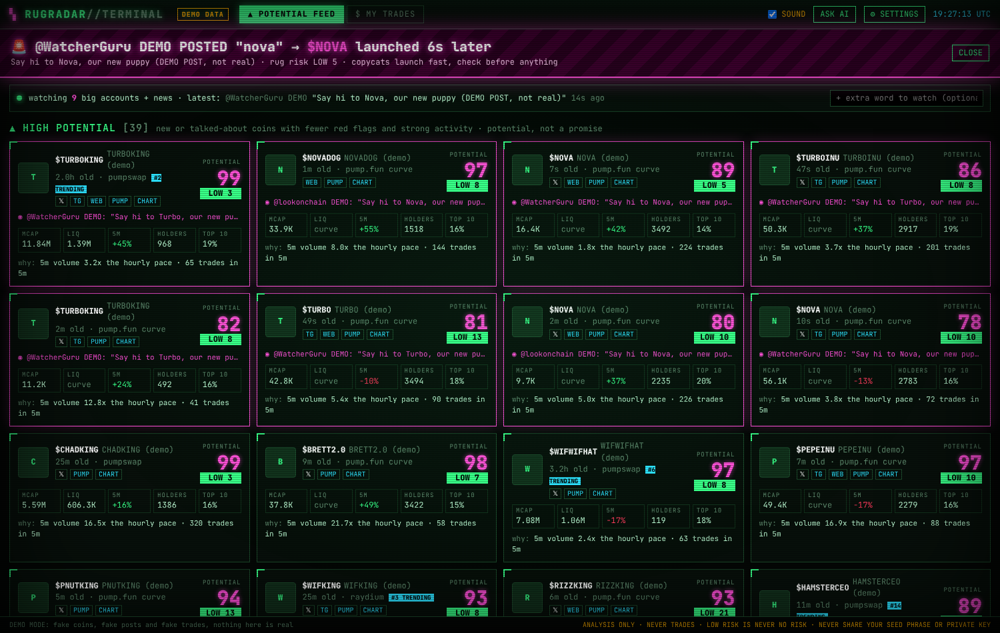

# RUGRADAR: Solana memecoin radar

One simple feed of new or talked-about Solana memecoins that pass a strict rug and bundle filter, a loud siren when a big account posts something a new coin is named after, and a page with your own trades and profit.

It does **not** tell you to buy or sell, never trades, and never asks for a private key or seed phrase. "Potential" means fewer red flags plus strong activity. It is never a promise.



## Start it (Windows)

1. Install Node.js from https://nodejs.org (the "LTS" button) if you haven't already.
2. Open the `memecoin-analyzer` folder.
3. Double-click **`start.bat`**. The dashboard opens in your browser at http://localhost:8787.

Want to try it with fake coins first? Double-click **`demo.bat`** instead.

To stop it, close the black window.

### Updates

Once updates are switched on (see `update-source.txt`), `start.bat` downloads the newest version every time you start it. Your keys and settings are kept. If a new version comes out while the app is open, an amber bar at the bottom tells you to close it and start it again. If there's no internet, it starts the version you already have.

## Everything is free

All coin data comes from free public sources: pump.fun, DexScreener, Jupiter, GeckoTerminal, RugCheck, Solana RPC, CoinGecko, Telegram public channels, Truth Social (via trumpstruth.org) and Google News.

Optional, in **⚙ SETTINGS**:

| Setting | What it does | Cost |
|---|---|---|
| Your Solana wallet **address** | Shows your trades and profit on MY TRADES (read-only) | Free |
| Solana RPC URL from Helius | Much faster rug, bundle and trade checks | Free (helius.dev) |
| Anthropic API key | The ASK AI chat | Paid per use, optional |

**Only ever paste your public address.** The app refuses anything that looks like a private key or seed phrase and never saves it. Nobody legit ever needs those.

## What's on the screen

- **Siren:** when a built-in big account (Trump on Truth Social, WatcherGuru, Lookonchain, Whale Alert, plus headlines about Elon Musk, Trump, CZ and MrBeast) posts a name and a coin with that name launches, a flashing banner and a loud siren go off. It shows how many seconds after the post the coin launched, and its rug risk. Copycats launch fast, so check first.
- **High potential feed:** the only list. It shows coins that are new (under 2 hours) or being posted or talked about, **and** pass every check: LOW or MEDIUM risk, most checks done, no red flag at all, and no big bundle at launch. The feed can be quiet. That's the filter doing its job.
- **Coin check:** click a coin for its picture, description, every link (X, Telegram, website, the post, pump.fun, chart, RugCheck, Bubblemaps, Solscan), the three scores and "What we found" in plain English.
- **My trades:** add your wallet address and see every swap with what you spent, what you got back, profit taken and open profit. Each winning sell gets a printed **profit receipt** with a stamp and a sound. New winning sells pop the receipt automatically.
- **Ask AI:** explains the risk on any coin. It won't tell you to buy or sell.

See [docs/rug-research.md](docs/rug-research.md) for every check, its threshold and where it comes from.

## Good to know

- Every news name gets dozens of copycat coins within minutes, and most are dumped fast. Always check the risk first.
- pump.fun launches coins faster than free data sources can check them all. Coins marked "checking" haven't been fully checked yet, so treat them as riskier.
- "Potential" means fewer red flags plus lots of activity right now. Coins that pass can still dump.
- TikTok has no free public API, so TikTok trends aren't included.
- Wallet tricks can hide holder concentration. The checks catch a lot, not everything.

## For the technical side

Commands: `npm start`, `npm run demo`, `npm test`. You can also set keys in `.env` (see `.env.example`).

```
server.js               web server, 1-second live stream, settings and watch-word API
src/engine.js           coin table, schedules each data source within its rate limit
src/score.js            rug-risk and hype scoring
src/newsmatch.js        turns posts and headlines into watch words, matches coin names
src/sources/news.js     built-in big accounts (Truth Social, Telegram), Google News, your words, alerts
src/wallet.js           your trades and profit from your public wallet address (read-only)
src/sources/*.js        DexScreener, PumpPortal, pump.fun info, Jupiter, GeckoTerminal, RugCheck, Solana RPC, trends
src/chat.js             AI analyst
src/update.js           tells the open dashboard when a newer version is published
update.ps1              downloads the newest version (run by start.bat), keeps .env
public/                 dashboard (terminal theme)
```

Real update speeds: new pump.fun launches arrive instantly. Prices for the most active coins refresh every second, and the rest every 10–25 seconds. Rug checks take about 2 seconds per coin, most active coins first. Big accounts are checked every ~30 seconds. Bundle checks run on one clean-looking coin at a time. Jupiter checks 50 coins every ~2 seconds, pump.fun coin info about 3 coins a second, GeckoTerminal trending every minute, headlines every 2 minutes, and your own watch words apply instantly.
